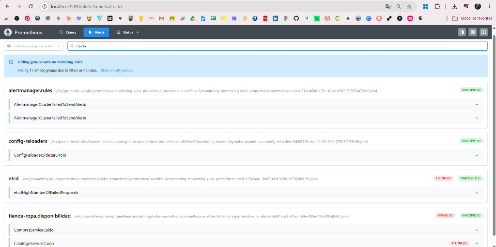
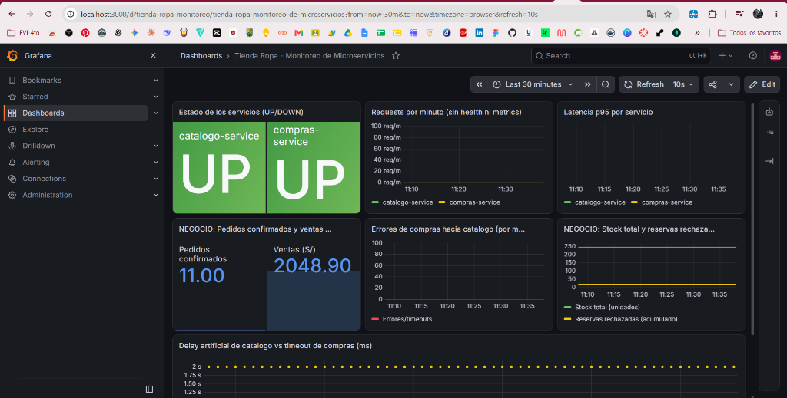
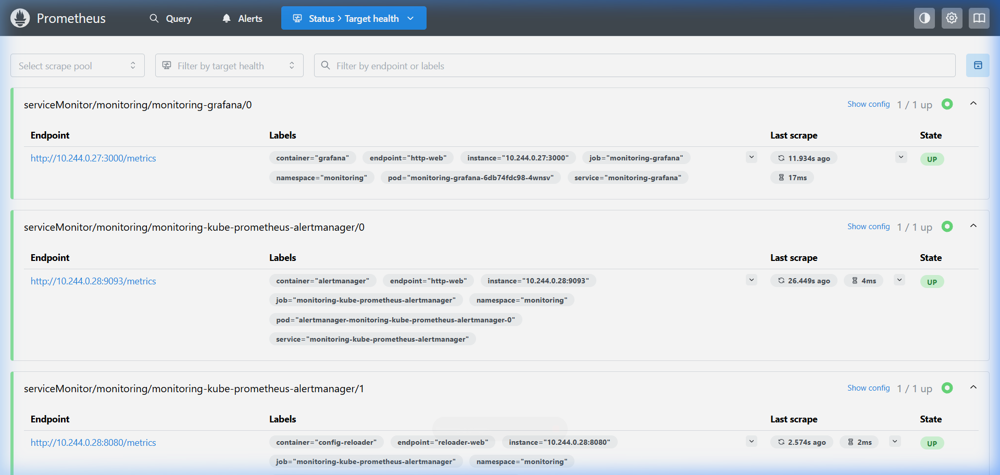
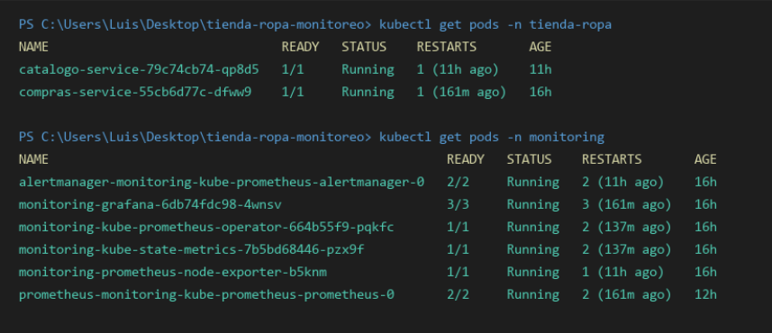

# Informe Técnico: Microservicios Java con Monitoreo en Kubernetes

- **Curso**: Kubernetes con Prometheus & Grafana — Valle Grande
- **Estudiante**: Luis Torres Benavente
- **Modalidad**: Individual
- **Dominio de Negocio**: Tienda de Ropa (Catálogo de Prendas y API de Compras)
- **Repositorio**: `tienda-ropa-monitoreo`

---

## Parte A — Conceptos Teóricos y Arquitectónicos

### 1. ¿Qué es Micrometer y por qué se usa en lugar de la librería directa de Prometheus?

**Micrometer** es una fachada de instrumentación de métricas dimensionales para aplicaciones Java, comparable a lo que es SLF4J para el registro de logs. Provee una API unificada para que el código de negocio no dependa directamente de una implementación o base de datos de series temporales concreta.

**Por qué se usa frente a la librería nativa `simpleclient` de Prometheus:**
1. **Desacoplamiento de infraestructura**: Si en el futuro la organización decide cambiar o enviar métricas concurrentemente a Datadog, InfluxDB, Dynatrace o CloudWatch, el código Java de nuestros servicios permanece inalterado; solo basta con cambiar la dependencia del registro en el archivo `pom.xml`.
2. **Integración nativa con Spring Boot 3**: Micrometer se acopla directamente con Spring Boot Actuator (`spring-boot-starter-actuator`), recolectando de forma automática métricas de JVM (recolección de basura, memoria heap/non-heap, hilos), métricas del servidor HTTP Tomcat/Netty y de clientes reactivos como `WebClient`.
3. **Manejo uniforme de etiquetas y percentiles**: Facilita agregar dimensiones (tags) y generar resúmenes con histogramas (`publishPercentileHistogram()`) calculados de manera eficiente en el cliente.

---

### 2. ¿Cuál es la diferencia entre Counter, Gauge y Timer? Da un ejemplo de cada uno tomado de tu código

| Tipo de Métrica | Comportamiento | Casos de Uso Típicos |
| :--- | :--- | :--- |
| **Counter** | Métrica acumulativa monótona creciente. Su valor solo puede subir o reiniciarse a cero cuando el proceso se reinicia. | Total de pedidos, errores de conexión, reservas exitosas. |
| **Gauge** | Medición instantánea que representa una "foto" del momento. Su valor puede subir y bajar dinámicamente en cualquier instante. | Nivel de inventario en almacén, memoria en uso, conexiones activas. |
| **Timer** | Mide tanto la duración (tiempo transcurrido) de un evento como la frecuencia o tasa con la que ocurre. | Latencia de llamadas HTTP a otros servicios, tiempo de consulta a base de datos. |

#### Ejemplos tomados directamente de nuestro código:

- **Counter** (en [`ComprasService.java`](../microservices/compras-service/src/main/java/com/tiendaropa/compras/service/ComprasService.java)):
  ```java
  pedidosConfirmados = Counter.builder("compras.pedidos.confirmados")
          .description("Pedidos confirmados")
          .register(registry);

  // Se incrementa cada vez que una compra concluye satisfactoriamente:
  pedidosConfirmados.increment();
  ```

- **Gauge** (en [`CatalogoService.java`](../microservices/catalogo-service/src/main/java/com/tiendaropa/catalogo/service/CatalogoService.java)):
  ```java
  Gauge.builder("catalogo.stock.total", productos,
                  m -> m.values().stream().mapToInt(Producto::stock).sum())
          .description("Unidades totales en stock")
          .register(registry);
  ```
  *Justificación*: El stock total de ropa fluctúa en tiempo real: disminuye cuando los clientes compran prendas y aumenta cuando se reabastece inventario.

- **Timer** (en [`ComprasService.java`](../microservices/compras-service/src/main/java/com/tiendaropa/compras/service/ComprasService.java)):
  ```java
  llamadaCatalogo = Timer.builder("compras.catalogo.llamada.duracion")
          .description("Duración de la llamada a catalogo-service")
          .publishPercentileHistogram()
          .register(registry);

  // Registro de la duración de la petición HTTP hacia el catálogo:
  return llamadaCatalogo.record(() -> {
      return catalogo.post()
              .uri("/productos/{id}/reservar?cantidad={c}", productoId, cantidad)
              ...
  });
  ```

---

### 3. ¿Qué es un ServiceMonitor y cómo sabe el Prometheus Operator qué monitorear?

Un **ServiceMonitor** es un recurso personalizado (*Custom Resource Definition* o CRD) proporcionado por el **Prometheus Operator** que define de manera declarativa cómo y de qué servicios de Kubernetes deben rasparse (*scrape*) las métricas.

**Mecanismo de detección del Prometheus Operator:**
1. El Prometheus Operator vigila constantemente el clúster a través de la API de Kubernetes en busca de objetos `ServiceMonitor`.
2. Para que Prometheus decida incluir un `ServiceMonitor`, las etiquetas del recurso deben coincidir con la configuración `serviceMonitorSelector` declarada en la instancia de Prometheus (gestionada en `values.yaml`).
3. Una vez aceptado el `ServiceMonitor`, este localiza los objetos `Service` de Kubernetes evaluando el selector `spec.selector.matchLabels`.
4. El operador genera dinámicamente la configuración de *scrape target* en Prometheus usando el nombre del puerto indicado (por ejemplo `port: http`), el path (por ejemplo `/metrics`) y el intervalo configurado (`interval: 15s`).

En nuestro archivo [`k8s/monitoring/servicemonitors.yaml`](../k8s/monitoring/servicemonitors.yaml):
```yaml
spec:
  selector:
    matchLabels:
      app: catalogo-service  # Coincide con labels.app del Service en catalogo.yaml
  endpoints:
    - port: http             # Apunta al puerto nombrado "http" en el Service
      path: /metrics         # Ruta expuesta por Spring Boot Actuator
      interval: 15s
```

---

### 4. ¿Cuál es la diferencia entre Liveness Probe y Readiness Probe?

Ambos son mecanismos de salud que el *kubelet* ejecuta periódicamente sobre los contenedores, pero con finalidades operativas muy diferentes:

- **Liveness Probe (Sonda de Vida)**:
  - **Objetivo**: Determinar si la aplicación sigue viva y en ejecución normal.
  - **Acción ante fallo**: Si la sonda falla consecutivamente hasta alcanzar el `failureThreshold`, el *kubelet* **mata el contenedor y lo reinicia** según su política de reinicio.
  - **Propósito**: Recuperar la aplicación de estados muertos irrecuperables (deadlocks, fugas críticas de memoria o hilos colgados).

- **Readiness Probe (Sonda de Disponibilidad)**:
  - **Objetivo**: Determinar si la aplicación está en condiciones de **recibir tráfico de red**.
  - **Acción ante fallo**: Si falla, el contenedor **no se reinicia**; en su lugar, Kubernetes retira inmediatamente la IP del Pod de los *Endpoints* del `Service`, evitando que los clientes envíen solicitudes a una instancia ocupada o inicializándose.
  - **Propósito**: Dar tiempo al arranque de la JVM y carga de datos en memoria sin interrumpir el servicio ni enviar errores HTTP 502/503 a los usuarios.

Ejemplo en nuestro deployment [`k8s/app/catalogo.yaml`](../k8s/app/catalogo.yaml):
```yaml
livenessProbe:
  httpGet:
    path: /health
    port: 8081
  initialDelaySeconds: 20   # Espera que la JVM caliente antes de monitorear
  periodSeconds: 10
readinessProbe:
  httpGet:
    path: /health
    port: 8081
  initialDelaySeconds: 10   # Comprueba disponibilidad temprana
  periodSeconds: 5
```

---

### 5. ¿Por qué es necesario apuntar Docker al daemon de Minikube antes de construir las imágenes?

Cuando ejecutamos `docker build` de forma predeterminada en nuestra máquina anfitriona (Windows o Linux), las imágenes generadas se almacenan en el registro local del Docker Desktop o del motor Docker del host.

Sin embargo, **Minikube** corre como un nodo aislado dentro de su propia máquina virtual o contenedor Docker, teniendo su **propio daemon de Docker independiente** con su propio almacenamiento de imágenes.

Si compilamos en el host sin vincular los entornos:
- Kubernetes dentro de Minikube buscará la imagen local (`imagePullPolicy: Never`) y no la encontrará, entrando en estado de error `ImagePullBackOff` o `ErrImageNeverPull`.

Al ejecutar:
```bash
eval $(minikube -p minikube docker-env)
```
Configuramos las variables de entorno del shell (`DOCKER_HOST`, `DOCKER_CERT_PATH`, etc.) para que cualquier comando `docker build` construya y registre las imágenes directamente en el motor interno de Minikube, permitiendo que los Pods arranquen de inmediato sin requerir un registro externo como Docker Hub.

---

### 6. ¿Qué ocurre si no configuras el selector de ServiceMonitors en el values.yaml del chart?

Por defecto, el chart de Helm `kube-prometheus-stack` tiene habilitada la directiva:
`serviceMonitorSelectorNilUsesHelmValues: true` y un selector que exige que los `ServiceMonitors` tengan la etiqueta `release: monitoring` y pertenezcan al mismo namespace donde se instaló el chart.

**Consecuencia directa de no configurarlo:**
Si creamos nuestros `ServiceMonitors` en el namespace de la aplicación (`namespace: tienda-ropa`) y sin la etiqueta del release de Helm, **Prometheus los ignorará por completo**. Como resultado:
- En `http://localhost:9090/targets` **no aparecerán** los microservicios `catalogo-service` ni `compras-service`.
- Grafana no recibirá ninguna métrica de nuestros servicios.

**Nuestra solución en [`k8s/monitoring/values.yaml`](../k8s/monitoring/values.yaml):**
```yaml
prometheus:
  prometheusSpec:
    serviceMonitorSelectorNilUsesHelmValues: false
    serviceMonitorSelector: {}           # Ignora exigencia de etiquetas de release
    serviceMonitorNamespaceSelector: {}  # Permite buscar en TODOS los namespaces
```
Esto le indica al Prometheus Operator que acepte cualquier `ServiceMonitor` creado en cualquier namespace del clúster.

---

## Parte B — Consultas PromQL de Nuestro Sistema

### 1. Tasa de requests por minuto del Servicio B (`compras-service`) en los últimos 5 minutos

Mide la cantidad promedio de pedidos creados y confirmados por minuto:
```promql
rate(compras_pedidos_confirmados_total{job="compras-service"}[5m]) * 60
```
*Alternativa considerando todo el tráfico HTTP gestionado por el microservicio:*
```promql
rate(http_server_requests_seconds_count{job="compras-service"}[5m]) * 60
```

---

### 2. Latencia p95 del endpoint más crítico de nuestro sistema (`POST /pedidos`)

Calcula el percentil 95 (el 95% de las compras se resuelven en un tiempo menor o igual a este valor) en segundos:
```promql
histogram_quantile(0.95, sum by (le) (rate(http_server_requests_seconds_bucket{job="compras-service", uri="/pedidos", method="POST"}[5m])))
```
*O mediante el Timer de comunicación hacia el catálogo:*
```promql
histogram_quantile(0.95, sum by (le) (rate(compras_catalogo_llamada_duracion_seconds_bucket[5m])))
```

---

### 3. Estado UP/DOWN de ambos microservicios al mismo tiempo

Permite visualizar en un solo panel de estado si tanto `catalogo-service` como `compras-service` están saludables (`1 = UP`, `0 = DOWN`):
```promql
up{namespace="tienda-ropa", job=~"catalogo-service|compras-service"}
```

---

### 4. Query de negocio propia de nuestro dominio: Monto total vendido en Soles (S/)

Consulta el Gauge de negocio en tiempo real que refleja el valor monetario total transaccionado en la tienda de ropa:
```promql
compras_ventas_total_soles{job="compras-service"}
```
*O tasa de rechazos de pedidos por falta de stock por minuto:*
```promql
rate(catalogo_reservas_rechazadas_total[2m]) * 60
```

---

## Parte C — Evidencias de Casuísticas

### 🔴 Casuística 1 — El Servicio Caído (Obligatoria)

- **Contexto narrativo**: Durante un despliegue en horario nocturno, un ingeniero de infraestructura modifica erróneamente la configuración del `catalogo-service`, alterando la ruta de salud del Liveness Probe a un endpoint inexistente (`/ruta-rota`).
- **Síntoma**: El clúster detecta fallos repetidos en la comprobación de vida. Kubernetes reinicia el contenedor cíclicamente ingresando en estado `CrashLoopBackOff`. En consecuencia, el servicio de compras no puede procesar pedidos y los clientes perciben cortes de servicio.
- **Activación**:
  ```bash
  kubectl patch deployment catalogo-service -n tienda-ropa -p '{"spec":{"template":{"spec":{"containers":[{"name":"catalogo-service","livenessProbe":{"httpGet":{"path":"/health-erroneo"}}}]}}}}'
  ```
- **Diagnóstico (Prometheus / Grafana)**:
  - En Prometheus (`/targets`), el target `catalogo-service` pasa a estado **DOWN (0/1 up)**.
  - En Prometheus (`/alerts`), la alerta `CatalogoServiceCaido` cambia de `Pending` a **FIRING**.
  - En Grafana, el panel "Estado de Servicios" cae de `1` a `0`.
- **Captura de Grafana mostrando la anomalía**:
  
- **Resolución**:
  ```bash
  kubectl apply -f k8s/app/catalogo.yaml
  kubectl rollout status deployment/catalogo-service -n tienda-ropa
  ```
- **Lección técnica**: Los *Liveness Probes* son vitales para detectar caídas de proceso o bloqueos permanentes, pero deben estar configurados apuntando a endpoints fiables y ultraligeros. Si la sonda falla, Kubernetes matará el contenedor; por ende, un probe mal parametrizado puede destruir la disponibilidad de un servicio saludable.

---

### 🟡 Casuística 2 — El Servicio Lento (Obligatoria)

- **Contexto narrativo**: El catálogo de productos experimenta congestión y lentitud en la validación de inventario. Simulamos este comportamiento configurando la variable de entorno `CATALOGO_DELAY_MS=3000` (3 segundos). Dado que `compras-service` tiene un timeout configurado de 2 segundos (`CATALOGO_TIMEOUT_MS=2000`), las llamadas de reserva empiezan a caducar.
- **Síntoma**: Los clientes intentan comprar prendas de vestir en la tienda, pero la solicitud tarda más de 2 segundos y finalmente falla arrojando un error `HTTP 503 Service Unavailable ("El catálogo no responde")`.
- **Activación**:
  ```bash
  # 1. Aplicar delay artificial de 3000 ms en el catálogo
  kubectl set env deployment/catalogo-service -n tienda-ropa CATALOGO_DELAY_MS="3000"
  kubectl rollout status deployment/catalogo-service -n tienda-ropa

  # 2. Generar tráfico continuo con stress.sh
  bash loadtesting/stress.sh -n 30 -d 0.5
  ```
- **Diagnóstico (Prometheus / Grafana)**:
  - El Gauge `catalogo_delay_artificial_ms` sube inmediatamente a `3000`.
  - El contador `compras_catalogo_errores_total` experimenta un incremento pronunciado.
  - La alerta `CatalogoLentoOConTimeouts` (`increase(compras_catalogo_errores_total[1m]) > 2`) pasa a estado **FIRING**.
- **Captura de Grafana mostrando la anomalía**:
  
- **Resolución**:
  ```bash
  kubectl set env deployment/catalogo-service -n tienda-ropa CATALOGO_DELAY_MS="0"
  kubectl rollout status deployment/catalogo-service -n tienda-ropa
  ```
- **Lección técnica**: En una arquitectura de microservicios, la latencia es transitiva y se propaga en cascada. Sin observabilidad mediante métricas de latencia (Timer) y monitoreo de timeouts, es casi imposible saber si la falla proviene del microservicio que atiende la compra o del servicio dependiente que tarda en validar el stock.

---

### 🟠 Casuística 3 — Agotamiento Crítico de Stock en Producto Estrella (Prenda de Alta Demanda)

- **Contexto narrativo**: En el lanzamiento de una campaña de invierno, se oferta la "Casaca de cuero" (`id: P003`), la cual posee un stock limitado de tan solo 5 unidades a un precio de S/ 299.90. Una oleada masiva de compras agota el producto en cuestión de segundos.
- **Síntoma**: Los primeros 5 clientes logran completar su compra exitosamente (`HTTP 201 Created`). Sin embargo, a partir del 6º intento, todos los compradores subsiguientes reciben un rechazo con error `HTTP 409 Conflict ("Stock insuficiente")`, perdiéndose oportunidades de facturación.
- **Activación**:
  ```bash
  # Ejecutar 15 pedidos continuos de la casaca de cuero (P003)
  bash loadtesting/stress.sh -n 15 -p P003 -q 1 -d 0.5 -c "comprador-invierno"
  ```
- **Diagnóstico (Prometheus / Grafana)**:
  - Las reservas exitosas se detienen en 5.
  - La métrica de Counter `catalogo_reservas_rechazadas_total` se incrementa a 10.
  - El inventario total en el Gauge `catalogo_stock_total` cae abruptamente.
  - La alerta de negocio `PedidosRechazadosPorStock` y `StockTotalBajo` cambian a estado **FIRING**.
- **Captura de Grafana mostrando la anomalía**:
  
- **Resolución**:
  ```bash
  # Reposición de inventario en memoria reiniciando el pod de catalogo
  kubectl rollout restart deployment/catalogo-service -n tienda-ropa
  kubectl rollout status deployment/catalogo-service -n tienda-ropa
  ```
- **Lección técnica**: Las métricas técnicas de infraestructura (CPU, RAM) no son suficientes para garantizar el éxito de un negocio digital. Un sistema puede tener 0% de errores de servidor (HTTP 500) y latencia óptima, y aun así estar perdiendo miles de soles porque el inventario no se repuso a tiempo. Monitorear métricas de dominio de negocio en Prometheus y Grafana es indispensable para la toma de decisiones comerciales.

---

## Parte D — Evidencias del Sistema en Funcionamiento

### 1. Captura de `/targets` en Prometheus con ambos servicios en estado UP
Verificación de que el Prometheus Operator descubrió correctamente los dos `ServiceMonitors` y ambos targets responden saludablemente (`State: UP (1/1 up)`).



---

### 2. Captura del Dashboard de Grafana con los 6 Paneles Funcionando
Visualización del tablero aprovisionado mediante [`dashboard.json`](../k8s/monitoring/dashboard.json), mostrando datos reales de la tienda de ropa:
- Estado de los servicios en `UP`.
- Pedidos confirmados (11.00) y Ventas Totales acumuladas en Soles (S/ 2048.90).
- Métricas de stock, delay artificial y errores/timeouts.


---

### 3. Captura de `kubectl get pods` mostrando todos los pods en Running
Salida de consola que certifica que todos los componentes tanto en el namespace `tienda-ropa` como en `monitoring` se encuentran en ejecución normal:



---

### 4. Captura de al menos una alerta en estado FIRING durante alguna casuística
Visualización en la interfaz de Prometheus (`/alerts`) evidenciando la regla de alerta `CatalogoServiceCaido` en estado **FIRING (1)** en color rojo tras la caída simulada del microservicio:


